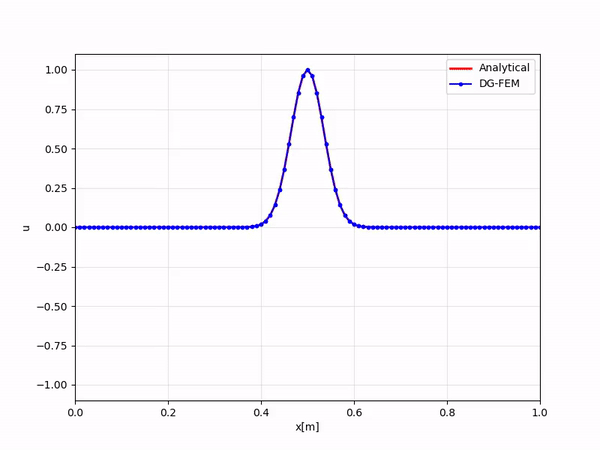

# DGFEM Wave Simulation (1D)
1D wave solver based on the discontinuous Galerkin finite element method (DG-FEM),
written in C++ and visualized with Python.

<p align="center">
  
</p>

## Governing Equation
### Wave Equation
1D wave equation on $0 \le x \le L$ with fixed ends:
$$
\frac{\partial^2 u}{\partial t^2} - c^2 \frac{\partial^2 u}{\partial x^2} = 0, \qquad u(0, t) = u(L, t) = 0
$$

Introducing $v = \partial u / \partial t$ and $s = \partial u / \partial x$, 
$$
\begin{aligned}
\frac{\partial v}{\partial t} - c^2 \frac{\partial s}{\partial x} = 0 \\
\frac{\partial s}{\partial t} - \frac{\partial v}{\partial x} = 0
\end{aligned}
$$

The system is written in the conservation form:
$$
\frac{\partial \mathbf{Q}}{\partial t} + \frac{\partial \mathbf{F}}{\partial x} = 0
$$

### Discontinuous Galerkin Method
The domain is divided into $N_e$ elements of length $h = L / Ne $.
On each element $[x_L, x_R]$, the equation is multiplied by a test function $\phi(x)$:
$$
\int_{x_L}^{x_R} \phi \frac{\partial \mathbf{Q}}{\partial t}\,dx + \int \phi \frac{\partial F}{\partial x} = 0
$$

Integration by parts moves the derivative:
$$
\int_{x_L}^{x_R} \phi \frac{\partial \mathbf{Q}}{\partial t}\,dx + [\phi F*]_{x_L}^{x_R} -  \int_{x_L}^{x_R} \frac{\partial \phi}{\partial x} \mathbf{F}\,dx = 0
$$

## Numerical Calculation
Introducing Mass-Matrix $M$ and Stiffness-Matrix, it is written as follows:
$$
M \boldsymbol{\dot Q} - S\boldsymbol{F} + \boldsymbol{F*} = 0
$$
Then it is transformed as ODE (Ordinary Differential Equation)
$$
\dot Q = M_{inv}(SF - F*)
$$

Time integration is calculated using Runge-Kutta 3-stage method.
## Contents
```
wave_1D_DG/
├── wave.cpp       # DG-FEM solver
├── snapshot.py    # draws a snapshot for every output time
├── run.sh         # compile, run, plot, and make movies
└── docs/
    └── demo.gif   # demo animation for this README
```

## How to Run
```
./run.sh
```
The contents of `run.sh` :
```bash
mkdir -p data snapshot movie              # output directories

for ne in 50 100 200 400 800              # number of elements
do
    g++ -O2 -DNe=$ne wave.cpp -o wave_$ne -lm     # compile
    ./wave_$ne >> conv.dat                        # error for each number of elements
    mv wave.dat data/wave_$ne.dat                 # snapshot data
    python snapshot.py $ne                        # draw a snapshot for every output time
    ffmpeg -r 30 -i snapshot/snapshot_$ne/frame_%05d.png \
        -vf scale="trunc(iw/2)*2:trunc(ih/2)*2" -vcodec libx264 -profile:v high \
        -preset slower -pix_fmt yuv420p -g 30 -y movie/snapshot_$ne.mp4   # make a movie
done
```
